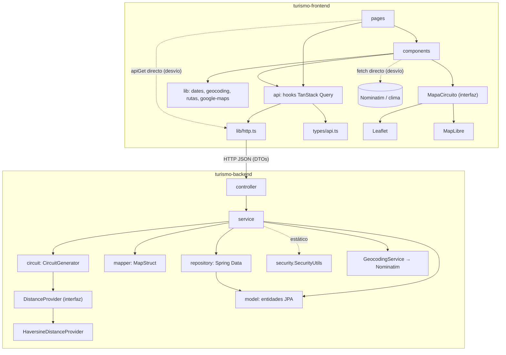

# Análisis de arquitectura — Viajesazo

> Fecha: 20/11/2026. Alcance: `turismo-backend/src/main` y `turismo-frontend/src` (sin tests ni
> `components/ui`, que genera shadcn). **No se modificó código**: este informe solo describe y
> propone. Las referencias `archivo:línea` corresponden al código de esta fecha.
>
> Método: lectura de `CLAUDE.md` y de los dos `AGENTS.md`; métricas por paquete (líneas, métodos,
> dependencias inyectadas, imports entre capas, `instanceof`, cadenas de getters); lectura dirigida
> de los archivos más grandes y de los que concentran lógica. **No se midió la frecuencia de cambio
> con `git log`** porque el historial no estaba disponible desde esta sesión.

---

## 1. Resumen ejecutivo

La arquitectura es **sana en lo grueso**:

- El backend respeta las capas `controller → service → repository`, sin dependencias circulares.
  Los controllers nunca tocan repositorios y el modelo no conoce DTOs ni services.
- El motor de circuitos (`circuit/`) está separado detrás de una abstracción (`DistanceProvider`).
- El reloj se inyecta (`Clock`), lo que hace testeable todo lo que depende de "hoy".
- El frontend tiene una capa de acceso a datos clara (`src/api` + `lib/http.ts` + `queryKeys`).
- El frontend tiene un muy buen ejemplo de "programar para una interfaz": `MapaCircuito`, con dos
  implementaciones (Leaflet y MapLibre).

Los problemas están **concentrados** en pocos lugares y son de cohesión y duplicación, no de
estructura. Los 5 hallazgos más importantes:

1. **`CircuitoService` es una clase Dios** (1.608 líneas, 15 métodos públicos, ~80 privados). Mezcla
   9 responsabilidades distintas: generación, consulta, edición, sustitución, sugerencias,
   disponibilidad, desactualización, métricas y armado de respuestas. Viola SRP y baja cohesión.
2. **Duplicación con un bug real.** La tabla "paradas por ritmo" está en 4 lugares y con valores
   distintos: backend 2/4/5 y frontend 1/3/5. También hay ~40 líneas copiadas entre
   `PropuestaService` y `ActividadService`, tres copias del filtro "está dentro del radio" y dos
   copias del chequeo "el viaje es del usuario".
3. **Lógica según el tipo con `instanceof`** en vez de polimorfismo. Hay 8 casos en
   `CircuitoService` para calcular horarios de `Evento` y de `Actividad`, cuando ese conocimiento
   le pertenece a cada subclase (Experto en información y OCP).
4. **El frontend saltea su propia capa en algunos lugares.** Hay `fetch` directo en componentes
   (clima y Nominatim) aunque ya existen `lib/clima.ts` y `lib/geocoding.ts`. Además, la
   abstracción de mapas solo se usa en 1 de los 8 mapas.
5. **Código muerto.** `CircuitoDetalleView` (446 líneas, sin usos), los DTOs y tipos del Sustituir
   viejo (`AlternativaReemplazoResponse` y `AlternativasReemplazoResponse`, en Java y en TS) y
   etiquetas duplicadas que ya no se usan.

**Nota general: 3,5 / 5.** El proyecto está bien estructurado para su tamaño. El riesgo principal
es que casi todo lo nuevo del circuito sigue cayendo en el mismo archivo.

---

## 2. Mapa de la arquitectura

### 2.1 Tamaños

| Backend (paquete) | Archivos | Líneas | | Frontend (carpeta) | Archivos | Líneas |
| --- | ---: | ---: | --- | --- | ---: | ---: |
| `service` | 16 | 3.588 | | `components` | 104 | 17.537 |
| `model` | 29 | 1.603 | | `pages` | 24 | 5.943 |
| `controller` | 14 | 939 | | `lib` | 15 | 2.955 |
| `security` | 12 | 683 | | `api` | 17 | 1.494 |
| `repository` | 14 | 620 | | `types` | 1 | 899 |
| `circuit` | 9 | 498 | | | | |
| `mapper` | 6 | 348 | | | | |
| `exception` | 8 | 303 | | | | |

Archivos más grandes:

- Backend: `CircuitoService` (1.608), `CircuitGenerator` (353), `ViajeService` (308),
  `PropuestaService` (262).
- Frontend: `evento-form.tsx` (1.265), `lib/viajezaso/data.ts` (1.009, datos de la demo),
  `planificador-page.tsx` (750), `sustituir-parada-panel.tsx` (688), `circuito-page.tsx` (631).

### 2.2 Dependencias



Dependencias entre services (sin ciclos): `ViajeService → CircuitoService`,
`PropuestaService → GeocodingService, NotificacionService`, `ActividadService → GeocodingService`,
`PublicadorAgendaService → InscriptosService`, `AuthService → JwtService, RefreshTokenService`,
`ViajeEstadoScheduler → ViajeService`.

---

## 3. Evaluación por principio

### 3.1 Cohesión — Backend 3/5 · Frontend 3/5

**Fortalezas**

- La mayoría de los services tienen un solo tema: `MeGustaService`, `InscriptosService`,
  `ImagenService`, `GeocodingService`, `DashboardService`.
- El paquete `circuit/` es muy cohesivo: solo genera alternativas a partir de candidatos.
- En el frontend, `src/api/*` está organizado por recurso y `lib/*` por tema (fechas, rutas, mapas,
  http). Ningún archivo de `lib/` importa componentes ni páginas.

**Problemas**

- **Alta: `CircuitoService` (`service/CircuitoService.java`)** tiene 1.608 líneas y estos bloques:
  - Generación y snapshot: `generate` (l.130), `candidates` (l.1079), `snapshot` (l.1023).
  - Consulta del seleccionado: `selectedDetail` (l.239), `selectedDays` (l.489).
  - Edición: `deleteSelectedItem` (l.245) y las variantes "antes de confirmar" (l.303 a 331).
  - Análisis de sustitución: `analyzeSubstitution` (l.603) a `kilometers` (l.823).
  - Sugerencias para días incompletos: l.353 a 398 y l.1352 a 1591.
  - Disponibilidad y desactualización: `refreshAvailability` (l.1175), `staleReasons` (l.1038).
  - Métricas: `recalculateMetrics` (l.573).
  - Armado manual de DTOs: 13 `new …Response(…)` en este archivo, contra MapStruct en el resto.

  Impacto: cualquier cambio en el circuito toca el mismo archivo, los tests de servicio crecen sin
  parar y es difícil entender qué parte usa qué constante.
- **Media: `components/evento-form.tsx`** tiene 1.265 líneas: formulario, mapa, agenda, imágenes y
  arancel en un solo componente, aunque ya existe la carpeta `components/evento-form/` con piezas
  extraídas.
- **Media: `pages/planificador-page.tsx`** tiene 750 líneas y 27 hooks (`useState`, `useEffect`,
  `useMemo`): orquesta los 10 pasos, la restauración desde la URL y la generación.

**Mejora propuesta (sin aplicar)**: partir `CircuitoService` por caso de uso y dejar una fachada
para que el controller no cambie:

```text
CircuitoService (fachada, delega)
 ├─ CircuitoGeneracionService   generate / select / candidates / snapshot
 ├─ CircuitoConsultaService     find / selectedDetail / refreshAvailability / staleReasons
 ├─ CircuitoEdicionService      delete / replace (seleccionado y alternativas) / renumber / métricas
 ├─ SustitucionAnalyzer         hueco del día, opciones, noEntran, orden (sin JPA: testeable puro)
 ├─ SugerenciasDiaService       daySuggestions / addSuggestedItem / discardDayNotice
 └─ CircuitoResponseMapper      todos los toXxxResponse
```

### 3.2 Acoplamiento — Backend 4/5 · Frontend 3,5/5

**Fortalezas**

- Ningún controller importa repositorios. Los controllers solo importan enums del modelo para
  `@RequestParam` (`PropuestaController.java:16-21`).
- No hay ciclos entre services, y ni `model` ni `circuit` importan `service` o `dto`.
- El contrato con el frontend está explícito: los DTOs son `record` en Java y en el frontend
  tienen su espejo en `types/api.ts`.
- En el frontend, las páginas y componentes piden datos con hooks de `src/api`, y las query keys
  están centralizadas en `api/queries.ts`.

**Problemas**

- **Media: acoplamiento estático a la seguridad.** Hay 17 usos de `SecurityUtils` (métodos
  estáticos) repartidos en 10 services (por ejemplo `CircuitoService.java:956` y `ViajeService.java:296` y
  `302`). Los services quedan atados a `SecurityContextHolder`, y los tests tienen que armar un
  contexto de seguridad (`TestSecuritySupport`) en vez de pasar un usuario.
- **Media: el frontend saltea su propia capa.**
  - `pages/planificador-page.tsx:256` llama a `apiGet` directo, en lugar de un `fetchViaje` de
    `api/viajes.ts` (el `fetchCircuito` de la línea siguiente sí sale de `api/`).
  - `components/top-app-bar.tsx:42` hace `fetch` del clima, aunque existe `fetchClimaDiarioCordoba`
    en `lib/clima.ts:65`.
  - `components/ubicacion-evento.tsx:95` hace `fetch` a `nominatim.openstreetmap.org`, aunque
    existe `lib/geocoding.ts` (`buscarLugar`, l.181), que además es lo que mockean los tests.
- **Baja: el contrato se duplica a mano.** Cada cambio de DTO obliga a tocar Java, `types/api.ts`,
  fixtures y handlers de MSW. Para el tamaño del proyecto es aceptable. Una alternativa sería
  generar los tipos desde OpenAPI.

### 3.3 SOLID

#### S — Responsabilidad única: 2,5/5

- Lo peor es `CircuitoService` (ver 3.1).
- **`PropuestaService` en realidad es el service de eventos.** Usa `EventoRepository` y
  `EventoMapper` y devuelve `EventoResponse` (`PropuestaService.java:38-48`), y lo usa
  `EventoController`. Coexiste con `PropuestaQueryService`, que sí trabaja sobre propuestas en
  general. El nombre engaña sobre su responsabilidad.
- Bien resuelto: las validaciones de negocio de una propuesta viven en la entidad
  (`PropuestaTuristica.validarInvariantes`, l.119) y no en el service.

#### O — Abierto/cerrado: 3/5

- **Estrategias de circuito.** `CircuitGenerator.choose()` (l.254) elige el comparador con
  `if (strategy == CERCANIA) … else if (DESCUBRIMIENTO) … else` (l.271 y 279). Agregar una cuarta
  estrategia obliga a editar el método y el enum, y además las etiquetas del frontend
  (`circuito-view-model.ts:46`).
- **Tipos de propuesta.** Agregar un tercer tipo (por ejemplo "Recorrido") obliga a editar los 8
  `instanceof` de `CircuitoService` (l.643, 850, 861, 893, 894, 1085, 1202, 1205) y los 2 de
  `PropuestaResumenMapper` (l.22-23).
- **Ritmo.** La tabla de paradas por ritmo está en `switch` duplicados: `CircuitGenerator.dailyLimit`
  (l.345) y `CircuitoService.dayMinimum` (l.1308).
- Bien resuelto: `DistanceProvider` deja cambiar Haversine por OSRM sin tocar el motor ni el
  service. Es el ejemplo de OCP del proyecto.

#### L — Sustitución de Liskov: 4/5

- `Evento` y `Actividad` respetan el contrato de `PropuestaTuristica`. Usan un **Template Method**
  (`validarInvariantes` llama a `validarInvariantesEspecificas`, l.119 y 145) y redefinen
  `getTipo()` y `tiposPermitidos()` sin romper nada.
- El uso de `instanceof` no viola LSP en sentido estricto. Pero es una señal de que los clientes no
  confían en la abstracción: preguntan por el tipo concreto en vez de pedirle algo a la propuesta.

#### I — Segregación de interfaces: 4/5

- Las interfaces propias son chicas: `DistanceProvider` tiene 2 métodos y `MapaCircuito` 6.
- Los repositorios extienden Spring Data y solo agregan las consultas necesarias.
- Punto a mejorar: el controller de circuitos depende de una única clase con 15 métodos públicos.
  Con la partición propuesta en 3.1, cada endpoint dependería solo del caso de uso que usa.

#### D — Inversión de dependencias: 3,5/5

- Bien resuelto:
  - Inyección por constructor en todos lados (`@RequiredArgsConstructor`).
  - `Clock` como bean (`config/AppConfig.java:16`).
  - `CircuitGenerator` recibe un `DistanceProvider` (l.28-30).
  - Los mappers son interfaces de MapStruct.
- **`GeocodingService` es una clase concreta atada a Nominatim** (`RestClient nominatimRestClient`,
  l.28). `PropuestaService` y `ActividadService` dependen de esa implementación. Una interfaz
  `Geocodificador` permitiría cambiar de proveedor o simularlo en tests sin red.
- `SecurityUtils` es estático (ver 3.2): es el principal desvío de DIP.

### 3.4 Ley de Deméter ("no hables con extraños") — Backend 3,5/5 · Frontend 4/5

- En el backend aparecen 20 cadenas de dos getters seguidos. La mitad están en `CircuitoService`:
  - `viaje.getUsuario().getId()` (l.147, 616, 957, 1366).
  - `viaje.getZonaInteres().getLatitud()` (l.978).
  - `zone.getLatitud().doubleValue()` dentro de `isEligible` (l.844-845), y lo mismo en
    `isEligibleIgnoringCategory` (l.1468-1469) y `distanceToZoneKm` (l.764-765).

  El service "abre" el viaje y la ubicación para hacer cuentas que podrían ser preguntas al objeto:
  `viaje.perteneceA(usuarioId)`, `viaje.estaDentroDelRadio(ubicacion, distanceProvider)` o
  `ubicacion.tieneCoordenadas()`.
- En el frontend, las cadenas como `query.data.content.length` (`publicadores-page.tsx:61`) recorren
  **estructuras de datos** (DTOs), no objetos con comportamiento. Deméter aplica mucho menos ahí y
  no se considera problema.

### 3.5 Programar para una interfaz, no para una implementación — Backend 3,5/5 · Frontend 3/5

- **Ejemplo modelo: `MapaCircuito`** (`components/planificador/mapa-circuito.ts:12`), con
  `setRuta`, `setParadas`, `setActiva`, `encuadrarRuta`, `setProgreso` y `destruir`. La animación
  de "Recorrer el día" habla solo con esa interfaz, y `mapa-circuito-leaflet.ts` y
  `mapa-circuito-maplibre.ts` son intercambiables (con vuelta a 2D si falla WebGL). Es el patrón
  **Adapter + Strategy** bien aplicado.
- **Pero hay 7 mapas más que usan Leaflet o MapLibre directo**: `evento-mapa.tsx`, `destino-mapa.tsx`,
  `parada-ubicacion-mapa-view.tsx`, `circuito-mapa-general-view.tsx`,
  `evento-form/evento-mapa-selector.tsx`, `ubicacion-evento.tsx` y el nuevo `sustitucion-mapa.tsx`.
  Cada uno repite la inicialización, y la URL de estilo está copiada en 5 archivos
  (`evento-mapa.tsx:8`, `destino-mapa.tsx:45`, `parada-ubicacion-mapa-view.tsx:10`,
  `circuito-mapa-general-view.tsx:11`, `evento-mapa-selector.tsx:27`). No hace falta que todos
  usen `MapaCircuito`, pero sí un módulo común `lib/mapas` (estilos, carga diferida, destrucción
  segura).
- En el backend: `DistanceProvider` sí; `GeocodingService` y `SecurityUtils` no (ver DIP). Que
  `CircuitoService` dependa de la clase `CircuitGenerator` está bien: hay una sola implementación
  y crear una interfaz hoy sería sobreingeniería.

### 3.6 GRASP

| Patrón | Nota | Evidencia |
| --- | ---: | --- |
| Experto en información | 2,5 | El cálculo de horarios de un `Evento` o una `Actividad` vive en `CircuitoService.proposalSlots` (l.849) y se repite en `eventSlots` y `activitySlots` (l.1095 y 1109). El experto es la propia propuesta: `PropuestaTuristica.horariosDelDia(LocalDate)` como método abstracto. Bien: `Viaje.planificar(Clock)` (l.104) y `PropuestaTuristica.cambiarEstado` validan su propio estado. |
| Creador | 4 | Las entidades se crean donde están sus datos: builders y mappers (`Evento.EventoBuilder`). `CircuitoService.toEntity` (l.1132) arma la alternativa desde el resultado del motor, que es razonable. |
| Controlador | 4,5 | Controllers finos: validan con `@Valid`, delegan en una línea y no tienen lógica (`CircuitoController.java:120-125`). |
| Bajo acoplamiento / Alta cohesión | 3 | Ver 3.1 y 3.2. |
| Polimorfismo | 2,5 | 10 `instanceof` en lugar de métodos redefinidos (ver OCP). |
| Indirección | 4 | `lib/http.ts` (refresh de token, errores) y `circuito-view-model.ts` (aísla a los componentes del formato de la API). |
| Variaciones protegidas | 3,5 | `DistanceProvider` y `MapaCircuito` sí. El proveedor de geocodificación y el de mapas base (fuera del circuito), no. |

### 3.7 DRY, KISS, YAGNI, composición, capas, errores y testeabilidad

**DRY: 2,5/5**

- **Alta (bug real): la tabla de ritmo está en 4 lugares** y no coinciden:
  - `CircuitGenerator.dailyLimit` (l.345) y `CircuitoService.dayMinimum` (l.1308) dicen 2/4/5.
  - `RITMO_MIN_PARADAS` en `circuito-dia-split-view.tsx:24` y `circuito-detalle-view.tsx:33`
    dice 1/3/5.
  - Las etiquetas dicen "1 a 2" y "3 a 4" paradas, y hay labels sueltos en `circuito-page.tsx:69` y
    `planificador-page.tsx:78`.

  El turista ve un rango y el sistema arma otro.
- **Media: `PropuestaService` y `ActividadService`** comparten ~40 líneas casi idénticas:
  `getPublicadorOrThrow`, `resolvePublicadorForWrite`, `assertCanManage`, `getInitialState` y
  `applyUbicacion` (`PropuestaService.java:159-205` contra `ActividadService.java:124-166`). Solo
  cambia la palabra "eventos"/"actividades" en los mensajes. Debería ser una
  `PublicadorAccessPolicy` común.
- **Media: "¿está dentro del radio?"** está 3 veces en `CircuitoService`: `isEligible` (l.827),
  `isEligibleIgnoringCategory` (l.1453) y `distanceToZoneKm` (l.756). Y "¿se pisa con otra
  parada?" está 2 veces: `overlapsAnotherItem` (l.881) y `overlapsAnyItem` (l.1492).
- **Media: "el viaje es del usuario actual"** está 2 veces: `CircuitoService.findTrip`
  (l.956-959) y `ViajeService.assertOwner` (l.301-306).
- **Baja: los paneles de Sustituir y Eliminar** se cablean igual en `paso-10-circuito.tsx` y en
  `circuito-page.tsx` (estados `stopToReplace` y `stopToDelete`, confirmaciones). Un hook
  `useEdicionParadas` lo unificaría.

**KISS: 4/5**

- Las soluciones son directas: Haversine en vez de un ruteo complejo, inscriptos contados en vivo
  en vez de una tabla, H2 sin perfiles.
- Excepción: `choose()` recibe **10 parámetros** (`CircuitGenerator.java:254-256`). Un objeto
  `ContextoEleccion` lo simplificaría.

**YAGNI y código muerto: 3/5**

- `components/planificador/circuito-detalle-view.tsx` tiene 446 líneas y no se usa: solo aparece
  en un comentario de `circuito-guardado-modal.tsx:8`.
- `dto/response/AlternativaReemplazoResponse.java` y `AlternativasReemplazoResponse.java`, y sus
  espejos en `types/api.ts:768-784`, ya no los usa nadie desde el Sustituir nuevo.
- En `CircuitoService` hay 20 nombres de paquete completos inline (por ejemplo
  `com.viajesazo.turismo_backend.model.EstadoViaje.CANCELADO`, l.953-956) en lugar de imports.
  Es ruido de lectura.

**Composición sobre herencia: 4/5**

- La única jerarquía de negocio (`PropuestaTuristica` → `Evento` / `Actividad`, JPA `JOINED`) está
  justificada.
- En el frontend todo es composición de componentes y hooks.

**Capas: 4/5**

- Controller, service y repository están bien separados.
- Los DTOs se arman con MapStruct, salvo en `CircuitoService` (manual) y `ViajeService.l.290`
  (manual): dos estilos para lo mismo.

**Manejo de errores: 4,5/5**

- `GlobalExceptionHandler` traduce un conjunto chico y claro de excepciones de dominio:
  - `BusinessRuleException` → 400.
  - `ConfirmationRequiredException` → 409.
  - `InvariantViolationException` → 422.
  - `ResourceNotFoundException` → 404.
  - `CircuitoDataMissingException` → 422 con `datosFaltantes`.
- La regla "un viaje ajeno da 404 y no 403" está aplicada de forma consistente.

**Testeabilidad: 4,5/5**

- El motor de circuitos se testea sin Spring.
- El reloj es inyectable.
- MSW con store *stateful* y `onUnhandledRequest: 'error'`.
- Los mapas están mockeados detrás de un módulo.
- Lo que más la frena es `SecurityUtils` estático y el tamaño de `CircuitoServiceTest`, que crece
  al mismo ritmo que el service.

### 3.8 Patrones de diseño

| Patrón | Dónde | Estado |
| --- | --- | --- |
| Layered / MVC | todo el backend | Bien aplicado |
| Repository | `repository/*` (Spring Data), `PropuestaSpecifications` (Specification) | Bien aplicado |
| DTO + Mapper | `dto/*` (records), `mapper/*` (MapStruct) | Bien, salvo los mapeos manuales del circuito |
| Template Method | `PropuestaTuristica.validarInvariantes` → `validarInvariantesEspecificas` | Bien aplicado |
| Strategy | `DistanceProvider`; `MapaCircuito` (2D/3D) | Bien aplicado |
| Strategy (faltante) | `CircuitStrategy` → `choose()` con if/else | **Falta**: una interfaz `OrdenCandidatos` por estrategia en un `EnumMap` |
| Adapter | `mapa-circuito-leaflet.ts`, `mapa-circuito-maplibre.ts`, `circuito-view-model.ts` | Bien aplicado |
| Facade | (propuesto) `CircuitoService` como fachada de los casos de uso | **Falta** |
| Builder | `Evento.EventoBuilder` | Bien aplicado |
| Snapshot / Memento | `CircuitoItem` guarda copia de la propuesta | Decisión consciente (ver 5) |
| State (simplificado) | `NombreEstado.puedeTransicionarA`, `EstadoViaje` | Bien aplicado |
| Observer | `NotificacionService` es llamado por los services de forma directa | Aceptable; con más eventos convendría usar eventos de Spring (`ApplicationEventPublisher`) |

---

## 4. Tabla de hallazgos

| Id | Principio | Archivo | Severidad | Esfuerzo | Prioridad |
| --- | --- | --- | --- | --- | ---: |
| H1 | DRY (bug) | `CircuitGenerator.java:345`, `CircuitoService.java:1308`, `circuito-dia-split-view.tsx:24`, `circuito-detalle-view.tsx:33` | Alta | Bajo | 1 |
| H2 | SRP / Cohesión | `CircuitoService.java` (1.608 líneas) | Alta | Alto | 2 |
| H3 | Experto / Polimorfismo / OCP | `CircuitoService.java:849, 1095, 1109`, `PropuestaResumenMapper.java:22` | Media | Medio | 3 |
| H4 | DRY | `PropuestaService.java:159-205` contra `ActividadService.java:124-166` | Media | Bajo | 4 |
| H5 | DRY / Deméter | `CircuitoService.java:756, 827, 1453` | Media | Bajo | 5 |
| H6 | YAGNI | `circuito-detalle-view.tsx`, DTOs y tipos `AlternativaReemplazo*` | Media | Bajo | 6 |
| H7 | Acoplamiento | `top-app-bar.tsx:42`, `ubicacion-evento.tsx:95`, `planificador-page.tsx:256` | Media | Bajo | 7 |
| H8 | DIP | `SecurityUtils` (17 usos en 10 services) | Media | Medio | 8 |
| H9 | OCP / Strategy | `CircuitGenerator.java:254-293` | Media | Medio | 9 |
| H10 | Interfaz / DRY | 7 mapas con Leaflet/MapLibre directo, estilo copiado en 5 archivos | Media | Medio | 10 |
| H11 | DIP / Variaciones protegidas | `GeocodingService.java:26-28` | Baja | Bajo | 11 |
| H12 | Cohesión | `evento-form.tsx` (1.265), `planificador-page.tsx` (750) | Media | Alto | 12 |
| H13 | SRP (nombre) | `PropuestaService` es el service de eventos | Baja | Bajo | 13 |
| H14 | DRY | Ownership de viaje duplicado: `CircuitoService.java:956`, `ViajeService.java:301` | Baja | Bajo | 14 |
| H15 | KISS | `choose()` con 10 parámetros | Baja | Bajo | 15 |
| H16 | Capas | DTOs manuales en `CircuitoService` y `ViajeService:290` contra MapStruct | Baja | Medio | 16 |

---

## 5. Decisiones conscientes

Cosas que parecen problemas pero tienen justificación (documentadas en los `AGENTS.md`):

- **El snapshot en `CircuitoItem`** (nombre, categoría, imágenes, coordenadas copiadas) parece
  datos duplicados. Es a propósito: si la propuesta cambia o se da de baja, el circuito sigue
  mostrando lo que se generó, marcado `disponible=false`. **Se sostiene.**
- **Inscriptos sin tabla propia** (conteo en vivo desde las paradas). Evita sincronizar dos
  fuentes, y sustituir o eliminar mueve la inscripción sin código extra. **Se sostiene.** Si el
  volumen creciera, se podría cachear.
- **"El motor no conoce Spring".** En realidad `CircuitGenerator` y `HaversineDistanceProvider`
  llevan `@Component` (l.20 y l.5) e importan enums del modelo. Es un acoplamiento mínimo de
  anotación, que no afecta los tests (se instancian con `new`). **Se sostiene**, pero la frase del
  `AGENTS.md` es más fuerte que la realidad.
- **Haversine en vez de OSRM en el backend.** Es simple, determinístico y no depende de la red;
  `DistanceProvider` deja la puerta abierta. **Se sostiene.**
- **Estado de la página en la URL** (`?page`, `?viaje`, `?alternativa`, `?dia`). Más trabajo, pero
  F5 y "atrás" funcionan. **Se sostiene.**
- **No editar `components/ui/`** (shadcn). Evita que `shadcn update` pise cambios. **Se sostiene.**
- **Tipos de la API escritos a mano en `types/api.ts`.** Es más simple que generar OpenAPI para
  una tesis; el costo es la duplicación (H16 / 3.2). **Aceptable.**
- **"Un viaje ajeno da 404".** No revela que el recurso existe. **Se sostiene.**

---

## 6. Recomendaciones por prioridad

Cada una indica si se puede hacer **sin romper funcionalidades** (cubierta por tests existentes).

1. **Unificar la tabla de ritmo (H1).** Sin romper funcionalidades. Una sola fuente en el backend
   (`TipoRitmo` con `minimoParadas()` y `maximoParadas()`, o un `RitmoPolicy`), y que el frontend
   la tome de un único `constants.ts` con los mismos valores. **Primero hay que decidir** qué rango
   es el correcto (2/4/5 o 1–2 / 3–4 / 5), porque cambia lo que ve el turista.
2. **Borrar código muerto (H6).** Sin romper funcionalidades: `circuito-detalle-view.tsx`, los DTOs
   y tipos `AlternativaReemplazo*` y los labels repetidos. Hay que correr tests y build después.
3. **Extraer `PublicadorAccessPolicy` (H4) y el ownership de viaje (H14).** Sin romper
   funcionalidades: es mover código idéntico a un componente y cambiar las llamadas. Lo cubren los
   tests de los controllers.
4. **Mover el conocimiento al modelo (H3, H5).** Sin romper funcionalidades si se hace en pasos:
   - `PropuestaTuristica.horariosDelDia(LocalDate)` abstracto, implementado en `Evento` y
     `Actividad`.
   - `Ubicacion.tieneCoordenadas()`.
   - `Viaje.distanciaALaZona(ubicacion, distanceProvider)`.
   - Que `CircuitoService` llame a esos métodos; los tests actuales del servicio lo validan.
5. **Partir `CircuitoService` (H2, H16).** Es el más grande. Sin romper funcionalidades si se deja
   `CircuitoService` como **fachada**: el controller y sus tests no cambian, y se extraen de a una
   las clases de la sección 3.1, corriendo los tests en cada paso. Conviene empezar por
   `SustitucionAnalyzer` y `CircuitoResponseMapper`, que son los más aislados.
6. **Strategy para `choose()` (H9, H15).** Sin romper funcionalidades: una interfaz
   `OrdenCandidatos` y una implementación por `CircuitStrategy` en un `EnumMap`, más un
   `ContextoEleccion` en lugar de 10 parámetros. `CircuitGeneratorTest` lo cubre.
7. **Respetar la capa de datos en el frontend (H7).** Sin romper funcionalidades: el `top-app-bar`
   pasa a usar `lib/clima.ts`, `ubicacion-evento` pasa a usar `lib/geocoding.ts`, y se crea
   `fetchViaje` en `api/viajes.ts`. Ojo: los tests de esos componentes pueden necesitar el handler
   MSW correspondiente.
8. **Inyectar el usuario actual (H8).** Riesgo medio: crear un `CurrentUserProvider` (interfaz) con
   una implementación sobre `SecurityContextHolder`, e inyectarlo en los services en lugar de la
   llamada estática. Simplifica los tests, pero toca 10 services.
9. **Módulo común de mapas (H10).** Riesgo medio: `lib/mapas` con estilos, carga diferida de
   Leaflet/MapLibre y destrucción segura, adoptado de a un mapa por vez. Son componentes visuales
   que conviene probar a mano además de los tests.
10. **Interfaz `Geocodificador` (H11)** y **renombrar `PropuestaService` → `EventoService` (H13).**
    Sin romper funcionalidades, con la ayuda del IDE para el renombre.
11. **Partir `evento-form.tsx` y `planificador-page.tsx` (H12).** Riesgo medio a alto: mucho estado
    compartido. Conviene hacerlo con tests de formulario a mano y en pasos chicos (un hook por
    paso, por ejemplo `usePlanificadorRestauracion`).

---

*Informe de solo lectura: no se cambió ningún archivo de código.*
